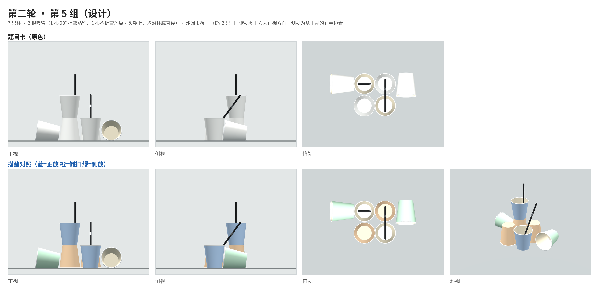

# Paper Cup Builder

A small 3D tool for building structures out of paper cups and straws and looking at their three orthographic views. It was made for a university psychology activity class, as the modelling and puzzle-making tool for Activity 2, “Seeing the Leopard Through a Tube” (from the Chinese idiom *guǎn zhōng kuī bào*: judging the whole from a glimpse).

- Load the target structures from both rounds of the activity and compare the 3D model with the photographed front, side and top views.
- Build new structures yourself; the panel on the right renders live front, side and top orthographic views that can be used directly as puzzle cards.
- A single-file offline version opens with a double-click from a USB stick on a classroom computer.
- The interface switches between English and Chinese with the button at the top right. It follows the browser language at first and remembers your choice; `?lang=en` or `?lang=zh` in the URL forces one.



## Background: Activity 2

The class theme is “drop the labels, avoid one-sided views, look from many angles”, built as three activities that move from people to objects to events:

| Activity | Name | What it is about |
|---|---|---|
| 1 | Getting to Know Each Other | People: not labelling others |
| 2 | Seeing the Leopard Through a Tube | Objects: rebuilding paper cups from three views |
| 3 | Unravelling the Threads | Events: lateral-thinking “turtle soup” puzzles |

How Activity 2 works: each team gets the three views of a paper-cup structure (front, side and top photos) and has to build the real cups to match.

Any single view leaves something out. Hidden cups, whether a cup is upright or inverted, which way a straw leans: these can only be settled by reasoning across all three views together, which is exactly the point of “avoid one-sided views, look from many angles”.

Both rounds live in the tool:

| Round | Groups | Content |
|---|---|---|
| Round 1 | 6 groups | Upright, inverted and stacked cups only; no side cups or straws |
| Round 2 | Groups 1–4 | Rebuilt from photos; adds cups on their side and straws |
| Round 2 | Groups 5–6 | Additional designed puzzles; their view sheets are in [`design/`](design) |

What groups 5 and 6 were designed around:

- 7 cups and 2 straws each.
- Each has a two-level stack whose lower cup is hidden in all three views; its orientation can only be worked out from the height of the cup above it.
- Each has an illusion in the front view:
  - Group 5 seems to show an hourglass, but its lower half is a separate inverted cup in the front row.
  - Group 6 seems to show two inverted cups stacked, but same-way cups would nest, so the upper one is actually further back: it is the top of a drum.

## Opening it

| Situation | How |
|---|---|
| Online | Once GitHub Pages is enabled for the repository, visit https://zzzhida.github.io/study/paper-cup-builder/ ; or download this folder and open `index.html` directly |
| Classroom (recommended) | Copy [`dist/paper-cup-builder-offline.html`](dist/paper-cup-builder-offline.html) to a USB stick and open it in Chrome or Edge on the classroom computer. No internet or sign-in needed |

Classroom tips:

- Press F11 for full screen; if text is small on the projector, press Ctrl and + to zoom the page.
- When setting the puzzle, untick “Colour by orientation” at the top right so the cups show in plain paper colour and nobody can tell which are upright and which are inverted; tick it again to reveal the answer.
- Old Internet Explorer has no WebGL and cannot show the 3D view. Very old graphics drivers will show “The 3D view failed to load”, so try it on that computer before class.

After editing `index.html`, regenerate the offline version with:

```bash
python3 tools/build_offline.py   # writes dist/paper-cup-builder-offline.html
```

## Printed contest cards

[`print/contest_cards_A4.pdf`](print/contest_cards_A4.pdf) has the 12 groups on 12 A4 pages, one group per page. Each page holds the front, side and top views in three equal strips separated by dashed cut lines, so it cuts into three cards. The cups are plain white, all three views share one light gray background so the black straws stand out, and the three views of a group share one scale. Labels on the cards are in Chinese, for the class. Print at 100% / actual size.

To regenerate after changing a structure (needs Node with Playwright, and Python with Pillow):

```bash
node tools/print_cards/render.js          # renders every view into tools/print_cards/out/
python3 tools/print_cards/compose.py      # lays them out as tools/print_cards/out/contest_cards_A4.pdf
```

## Controls

| Action | How |
|---|---|
| Switch structure | Drop-down at the top left (Round 1 / Round 2 / Free build) |
| Orbit and zoom | Drag to orbit, scroll to zoom |
| Place a cup | Pick “Upright 1”, “Inverted 2” or “On its side 3” and left-click the table; click the top of an existing cup to stack on it |
| Direction of side cups and straws | The “Facing” buttons (Front / Back / Left / Right), or press R to cycle |
| Add a straw | Pick “Straw 4”, then “Bent 90°”, “Straight · head up” or “Straight · head down”, and left-click an upright cup |
| Remove | Right-click it, or pick “Remove 5” and left-click it. One thing per click: straws first, then the top cup |
| Undo | The “Undo” button at the top, or Ctrl+Z |
| Flip the side view | “Other side” under the side view |
| Switch language | “中文” / “English” button at the top right |
| Save / load a layout | “Copy code” gives a JSON snippet; paste it back and click “Load the code above” |

Free builds are saved automatically in the current browser’s localStorage; to take one to another computer, use “Copy code”.

## Placement rules

These come from how real paper cups behave and from the rules agreed for the class. The builder enforces them.

**Cups**

- Every cup, or every stack, must touch at least one other cup; no cup may stand on its own. Removing a cup is refused if it would leave a neighbour on its own.
- Only an inverted cup can go on an upright one (rim to rim, a “drum”), and only an upright cup on an inverted one (base to base, an “hourglass”). Same-way cups would nest.
- At most three levels. Nothing can be stacked on a cup lying on its side or on a cup holding a straw.
- To decide whether two cups touch, the builder compares their radii level by level up the height. The cups taper, so when an upright cup stands beside an inverted one, their radii add up to 6.4 cm at every height; at a centre distance of 6.4 cm they touch along their whole height. Up to about 1.5 cm further apart still counts as touching.

**Straws**

- Straws only go in a cup whose top level is upright; cups on their side take none.
- They run front–back or left–right only, along a diameter of the cup floor. Two straws per cup at most.
- Two ways to place one:
  - **Bent 90°**: the short piece lies flat on the cup floor and the long piece stands straight up against the wall, so the long piece is off-centre.
  - **Straight, leaning**: the straw is not bent; its lower end rests at the edge of the floor on one side and it leans on the opposite rim. Either “head up” (bellows at the top) or “head down” (bellows on the floor).
- Two straws on the same diameter lie side by side with a gap of about 0.5 cm running exactly along the diameter, as in the round 2, group 4 photo. When two straws cross at right angles, the second rests on top of the first.

## Model dimensions

| Item | Value |
|---|---|
| Paper cup | Rim radius 3.75 cm, base radius 2.65 cm, height 8.2 cm |
| Grid unit | 1 cup diameter = 7.6 cm; free builds snap to 0.5 cup diameters |
| Straw | Long piece 15.2 cm, bellows 1.3 cm, short piece 4.6 cm, radius 0.3 cm |

A cup lying on its side tilts naturally by its taper angle, so the rim end is raised.

## Data format

The preset structures are the `R1`, `R2` and `R2D` arrays in `index.html`.

Coordinates are measured straight off the top-view photo: `u` to the right, `v` downward, in cup diameters. Two directions are recorded as well:

- `front`: which edge of the top photo the front-view camera stood at; `W`, `E` and `S` mean left, right and bottom.
- `side`: whether the side view was taken from the front viewer’s right (`R`) or left (`L`).

The code uses these two to convert photo coordinates into 3D world coordinates.

```js
// Round 2, group 4: front view taken from the left edge of the top photo, side view from the front viewer's right
{ front: 'W', side: 'R', items: [
  it(0,-1.95,'D'), it(-0.05,-1.0,'S',{open:[-1,0]}), it(1.0,-1.05,'BR'), it(-1,0,'D'), it(0,0,'U'),
  it(1,0,'U',{straws:[bent([-1,0],1), straight([1,0],'down',-1)]}) ] }
```

| Field | Meaning |
|---|---|
| `U` / `D` | Upright / inverted |
| `HG` | Hourglass: inverted below, upright on top |
| `BR` | Drum: upright below, inverted on top |
| `S` | On its side; `open` is the direction the mouth faces |
| `bent(dir, side)` | Straw bent 90°; the long piece stands against the wall on side `dir` |
| `straight(dir, head, side)` | Unbent straw leaning on the rim on side `dir`; `head` is `'up'` or `'down'` |
| `side` | When two straws share a diameter, which half of it this one takes (+1 / −1) |

## Files

```
index.html              the builder (three.js r128 + OrbitControls)
vendor/                 local copies of three.js and OrbitControls (MIT)
img/                    photos: g1–g6 are round 1, r2g1–r2g4 are round 2, each with _front/_side/_top
design/                 view sheets for round 2, groups 5 and 6 (puzzle card + answer key)
dist/                   single-file offline version
tools/build_offline.py  script that builds the offline version
tools/print_cards/      scripts that render and lay out the A4 contest cards
print/                  the A4 contest cards (PDF)
```

## Credits

Activity design and photos by Group 7 of the psychology activity class. 3D modelling and the builder were made together with Claude.
